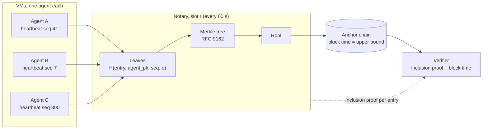
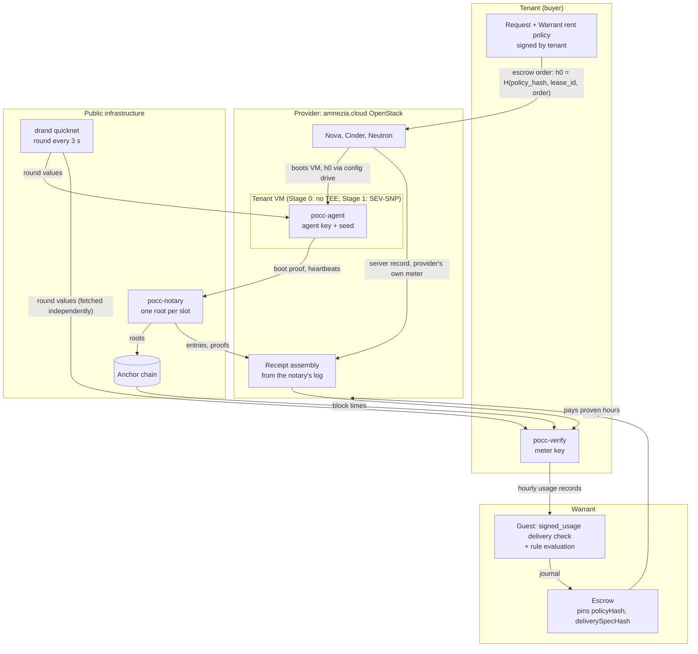
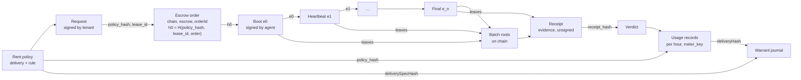

# PoCC architecture

Status: proof of concept, Stage 0. Spec: *PoCC Proof of Concept — Spec v0.2*
(Claude doc "Proof of Cloud Compute (PoCC) — PoC spec").

PoCC proves sampled liveness of a rented machine, without trusting the provider's
meter: an agent key born inside the machine signed a heartbeat on every 60 s beacon
slot, and each heartbeat was anchored in time. It credits the 60 s between two
consecutive anchored heartbeats and nothing else. The proof starts in the tenant's
signed request, which carries the Warrant policy, and ends when Warrant's escrow pays
for credited hours only.

What this does and does not establish (audit of 2 Nov, finding 1):

| Property of "delivered compute" | Stage 0 | Stage 1 (SEV-SNP) | Later |
|---|---|---|---|
| Instance availability, sampled every 60 s | Yes, if the provider does not extract the agent key and run the signer elsewhere; only while the tenant lets the agent run (§2a) | Yes: the key is born inside an attested machine; the tenant can still stop the agent | Evidence the tenant cannot reach (decision 47) |
| Hardware identity and launched image | No (Nova's own record only) | Yes: launch measurement, VCEK chain | — |
| Resource allocation (vCPUs, memory, GPU) | No | Partly: the attested image reads the hardware it sees | Stage 1 counters and GPU evidence (spec §11) |
| Performance | No | No | Throughput checks, `tau_max` (deferred, decision 10) |
| Job correctness | No | No | Job commitments, sampling, re-execution (decision 02) |

Two timely heartbeats are two observations. Availability between them is the Stage 0
assumption, bounded by the slot length; duty cycling inside a slot is not caught
(decision 06).

## 1. Roles

| Role | Runs where | Holds | Trusted for | Not trusted for |
|---|---|---|---|---|
| Tenant | Buyer's machine | Ed25519 signing key, X25519 seal key | Its own request and policy | — |
| Provider (seller) | A clearly identified reseller renting the machine from an OpenStack cloud under its own account, with an explicit spending limit at the cloud (pilot arrangement, decision 33) | Escrow recipient key, cloud credentials | Accepting the escrow order; paying the cloud's own invoice; terminating the machine and its volumes | Meter readings, coverage, billing |
| Cloud (amnezia.cloud) | OpenStack | — | Nothing of Warrant; it does not accept Warrant payments | Running the machine; it bills the reseller on its own terms |
| Agent (`pocc-agent`) | Inside the tenant's VM | Agent key and disclosure seed, created at boot | Producing heartbeats (Stage 0: assumes the provider does not read VM memory) | Running: the tenant can stop it, block it or read its key (§2a) |
| Notary (`pocc-notary`) | Any host with a public IP | Anchor wallet or anchor key | Nothing; everything it serves is checkable | Time, order, content |
| Beacon (drand quicknet) | Public network | — | Unpredictable values on a fixed 3 s schedule | — |
| Anchor chain | The chain Warrant's escrow uses | — | Block time and append-only history | — |
| Verifier / meter (`pocc-verify`) | Tenant side, or anyone | Meter key named in the policy | Running the verifier correctly; anyone can re-run it | — |
| Warrant | Guest program and escrow | Escrowed funds | Enforcing the policy | — |

## 2. Why there is a notary

A heartbeat signed inside the VM proves the VM was alive **after** a drand round,
because it contains that round's unpredictable value. It does not prove the
heartbeat existed **before** some later time. Without an upper time bound, a
provider could hold a VM paused, then later generate heartbeats for all the
missed rounds in a burst and claim the VM was running all along.

The notary closes that gap. It collects every agent's heartbeat for a slot,
builds one Merkle tree, and posts the root to a chain. The block time is the upper
bound. The verifier requires `0 ≤ block_time − round_time ≤ 30 s` for every
heartbeat.

The notary is **not trusted**:

- It cannot forge heartbeats. They are signed by agent keys it does not hold.
- It cannot move time. The beacon fixes the lower bound and the chain fixes the
  upper bound.
- It cannot alter a batch after posting. Inclusion proofs are checked against the
  root on chain.
- It can refuse or delay entries. That shows up as gaps, which earn no credit, so
  a provider gains nothing by running a notary that misbehaves.

Because one root per slot covers every VM, anchoring costs 1,440 transactions a
day in total, however many VMs there are. Anyone can run the notary: the tenant,
the provider, a third party, or Mnemonik as an anchoring service.



## 2a. The tenant controls the agent

The agent runs inside the tenant's VM, and the tenant has full control of it. The
tenant can stop the agent, block its network, or read the agent key from memory and sign
with it. Stage 0 cannot prevent this, and Stage 1 as specified does not either
(decision 47).

What the tenant cannot do:

- It cannot change anchored evidence. The notary keeps the first entry for each agent and
  sequence number and refuses a different one (`ErrFork`). The verifier's fork check
  reads the same log.
- It cannot make the earlier prefix invalid. The receipt over the entries up to the last
  valid one still verifies.

What the tenant can do with the extracted key, besides stopping the agent:

- It can submit a correctly signed but malformed heartbeat. The notary checks only the
  signature and the sequence, not the contents, so it accepts the entry. A receipt that
  includes it is `INVALID` and gives zero usage records.
- It can sign an early final heartbeat, which ends credit from that point on.

Therefore the seller checks each new entry with the verifier before it counts as
liveness, keeps the last valid receipt prefix, and builds usage records from that prefix
only. It stops the machine on a failed entry, an early final heartbeat, or
`liveness_miss_slots` slots without a valid anchored heartbeat (Warrant lease evidence
SS-12). It stores every anchored entry within one slot (SS-13). Time without valid
anchored heartbeats is never paid, and heartbeats inside a provisional piece are not
billable by themselves.

The usage record that the meter signs binds the receipt hash, and the verifier is
deterministic. The seller's own verifier run therefore detects a false record at once,
and anyone can refute it from the kept receipt. Settlement still trusts the meter's
signature until the verifier runs inside the guest (X-1).

A sidecar that the tenant cannot stop, and an observer, are kept as research for a later
improvement: [research-sidecar-observer.md](research-sidecar-observer.md).

## 3. Components and trust boundaries



## 4. The proving cycle

```mermaid
sequenceDiagram
    autonumber
    actor T as Tenant
    participant P as Provider (OpenStack)
    participant A as Agent (in VM)
    participant D as drand
    participant N as Notary
    participant C as Anchor chain
    participant V as Verifier (meter)
    participant W as Warrant guest + escrow

    T->>T: write rent policy (delivery = signed_usage, meter_key, meter_spec)
    T->>P: Request (resources, period, image, meter_spec, policy), signed
    T->>W: fund escrow: offer(policyHash, deliverySpecHash, ceiling)
    P->>W: accept(orderId)
    P->>A: create server (Nova), h0 = H(policy_hash, lease_id, chain, escrow, orderId) in config drive

    A->>D: next slot round r0
    A->>A: new agent key + seed, e0 = H(h0, server, key, r0, rand0, seed_enc)
    A->>N: boot proof (seq 0)
    loop every slot (rounds divisible by 20, 60 s)
        A->>D: round r_i
        A->>A: u_i = salted usage commit, e_i = H(e_{i-1}, i, r_i, rand_i, u_i)
        A->>N: heartbeat i, signed
        N->>C: one Merkle root for all VMs
    end
    A->>N: final heartbeat, key erased
    P->>P: delete server

    V->>N: fetch entries and inclusion proofs
    V->>V: Receipt (request, escrow order, boot, heartbeats, proofs); no bill, no signature
    V->>D: fetch every round independently
    V->>C: check roots and block times
    V->>V: verify chain, bind to h0 and policy, credit per hour
    V->>W: usage record per hour, signed with meter_key
    P->>W: note per hour (the bill)
    W->>W: check record under meter_key, note ≤ units × price (D5), evaluate rule
    W->>P: pay proven hours, remainder returns to tenant after settle-by
```

## 5. What binds to what

Every arrow is a hash inclusion, so changing any earlier artifact breaks every later one.



## 6. Constructions

All hashes are SHA-256 with a domain tag, `H(tag, parts…)`, where each part is
length-prefixed (see [deviations](#8-deviations-from-the-spec)).

| Item | Construction | Code |
|---|---|---|
| Boot binding | `e0 = H(boot, h0, server_id, agent_pk, gpu_id, r0, rand0, H(seed_enc))` | `pkg/pocc/chain.go` |
| Heartbeat | `e_i = H(hb, e_{i-1}, i, r_i, rand_i, u_i, final_i)` | `pkg/pocc/chain.go` |
| Usage salt | `s_{i,k} = HMAC(seed, i ‖ name_k)` | `pkg/pocc/usage.go` |
| Usage leaf | `ℓ_{i,k} = H(leaf, s_{i,k}, name_k, v_{i,k})` | `pkg/pocc/usage.go` |
| Usage commit | `u_i = H(usage, ℓ_{i,cpu}, ℓ_{i,gpu})` | `pkg/pocc/usage.go` |
| Notary leaf | `H(entry, agent_pk, seq, e)` | `pkg/pocc/chain.go` |
| Batch tree | RFC 9162 Merkle tree and inclusion proofs | `pkg/pocc/merkle.go` |
| Seed sealing | X25519 + HKDF-SHA256 + AES-256-GCM, to tenant and provider | `pkg/pocc/seal.go` |
| Credit | the boot and every heartbeat sit on 60 s slots; each pair of consecutive slots earns 60 s when both are anchored within 30 s of their round; a gap, a late entry and every interval touching them earn nothing | `pkg/verify/verify.go` |
| Agent clock | drand's latest round, not the VM clock; a slot reached more than 15 s late is skipped | `pkg/agent/agent.go` |

## 7. Repository layout and status

| Path | What | Status |
|---|---|---|
| `internal/canon` | Canonical JSON (RFC 8785 subset: integers only) | Done |
| `pkg/pocc` | Artifact types, hashing, signing, usage commitments, sealing, Merkle, rent policy | Done, unit-tested |
| `pkg/beacon` | drand HTTP client, slot arithmetic, fake beacon for tests | Done |
| `pkg/anchor` | Anchor interfaces; signed-file dev anchor | Done; chain anchor planned |
| `pkg/notary` | Entry intake, per-slot batches, proofs, HTTP API | Done |
| `pkg/verify` | Verifier (spec 5) with policy checks, hourly usage records | Done |
| `pkg/agent` | Boot proof, heartbeat loop, counters, final heartbeat | Done |
| `cmd/*` | `pocc-agent`, `pocc-notary`, `pocc-verify`, `pocc-broker` | Done; smoke-tested locally against real drand |
| `internal/sim` | Simulated acceptance tests T1, T3, T4, T6–T9 plus Stage 0 and policy checks | Done; T6 is Warrant gate D5 on the usage record |
| `pkg/openstack` | Minimal OpenStack client for the broker | Done; used in the 2026-10-28 live test (pre-escrow fixtures, kept as history) |
| `pkg/lease` | The seller's lease state machine and reservation ledger of lease evidence 5a.5 and 5a.6: provisional pieces, the challenge timeout, batches that close once, `deadline(b)`, SS-10; the DL-11 scenarios as tests | Done (PC-5); the service that drives it is PC-3 |
| `pkg/adapter/warrant` | The only package that knows Warrant's shapes: policy check, usage records as Warrant JSON, external signer | Done (PC-1, PC-2); awaits Warrant's `sign-usage` and `check rent` |

## 7a. One mode: the policy decides the proof

PoCC has no mode of its own (decision 30). The buyer's signed policy names the
delivery kind; PoCC runs only when it says `signed_usage` with a `meter_spec`. A
buyer who is content with the provider's word picks Warrant's `signed_acceptance`
instead, and PoCC is not involved.

| | Where it comes from |
|---|---|
| The order | The consumer's escrow order: `{chain_id, escrow, order_id}`; the provider's acceptance is `accept(orderId)` |
| `h0` | `H(order ‖ policy_hash ‖ lease_id ‖ chain_id ‖ escrow ‖ orderId)` |
| Timing and notary | The Request's `meter_spec`, mandatory and tenant-signed |
| Price | The consumer policy's `price_per_unit`, at most the Request's maximum |
| Policy check | `E_POLICY` from the consumer adapter; `E_PERIOD` unless the period starts on a clock hour |
| Billing | The consumer's notes, checked against the usage records (Warrant gate D5). The receipt carries no bill and no signature |

The consumer adapter registers with `verify.RegisterConsumer(name, check)`; the core
never imports an adapter. `pkg/adapter/warrant` is the first.

## 8. Deviations from the spec

- **Length-prefixed hashing.** The spec writes `H(a ‖ b)`. The code prefixes every
  part with its 4-byte length so no two different inputs concatenate to the same bytes.
- **No BLS check of drand signatures.** The verifier fetches every round from drand
  itself and compares values; it also checks `randomness = SHA-256(signature)`.
- **Dev anchor.** Until the chain anchor lands, the notary signs `(root, time)` with an
  anchor key. That is only as honest as the notary and is for development only.
- **Late anchoring costs credit, not validity.** An entry anchored more than 30 s
  after its round earns nothing and is counted in the verdict's `late`; an anchor
  time before its round is fatal (`E_ANCHOR_TIME`). Found in the live test, where a
  paused VM's frozen clock produced stale heartbeats.
- **Stage 1 (SEV-SNP) is not implemented.** A request with attestation `sev-snp`
  verifies as `E_SNP_UNSUPPORTED`.
