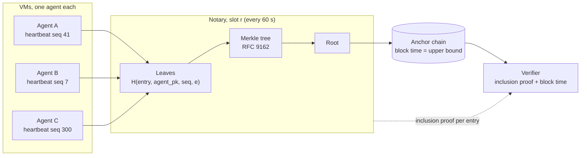
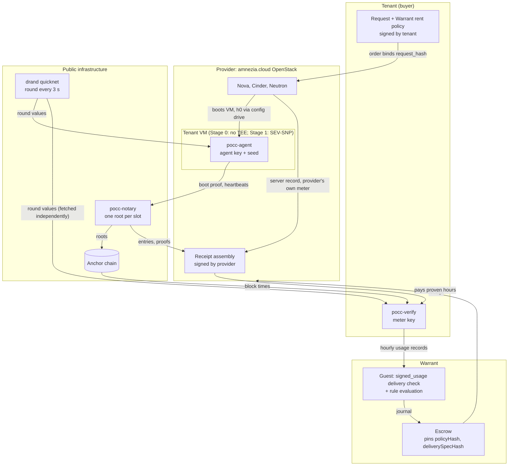
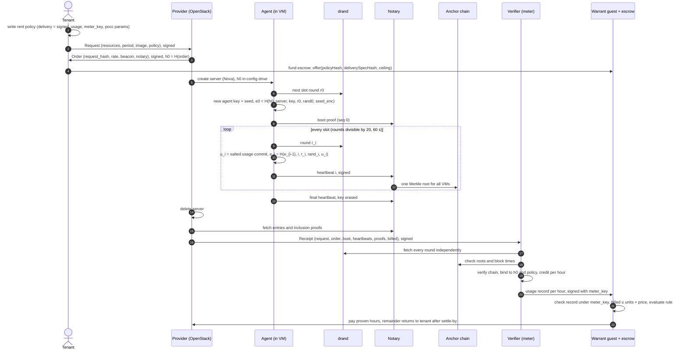
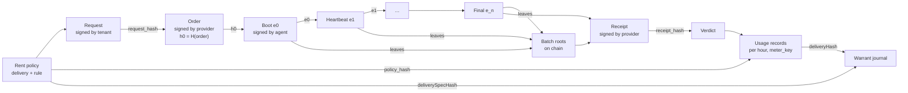

# PoCC architecture

Status: proof of concept, Stage 0. Spec: *PoCC Proof of Concept — Spec v0.2*
(Claude doc "Proof of Cloud Compute (PoCC) — PoC spec").

PoCC proves that ordered cloud compute was delivered for the time it is billed,
without trusting the provider's meter. The proof starts in the tenant's signed
request, which carries the Warrant policy, and ends when Warrant's escrow pays for
proven hours only.

## 1. Roles

| Role | Runs where | Holds | Trusted for | Not trusted for |
|---|---|---|---|---|
| Tenant | Buyer's machine | Ed25519 signing key, X25519 seal key | Its own request and policy | — |
| Provider | OpenStack cloud (amnezia.cloud) | Ed25519 signing key, X25519 seal key | Signing its order and receipt | Meter readings, uptime, billing |
| Agent (`pocc-agent`) | Inside the tenant's VM | Agent key and disclosure seed, created at boot | Producing heartbeats (Stage 0: assumes the provider does not read VM memory) | — |
| Notary (`pocc-notary`) | Any host with a public IP | Anchor wallet or anchor key | Nothing; everything it serves is checkable | Time, order, content |
| Beacon (drand quicknet) | Public network | — | Unpredictable values on a fixed 3 s schedule | — |
| Anchor chain | The chain Warrant's escrow uses | — | Block time and append-only history | — |
| Verifier / meter (`pocc-verify`) | Tenant side, or anyone | Meter key named in the policy | Running the verifier correctly; anyone can re-run it | — |
| Warrant | Guest program and escrow | Escrowed funds | Enforcing the policy | — |

## 2. Why there is a notary

A heartbeat signed inside the VM proves the VM was alive **after** a drand round,
because it contains that round's unpredictable value. It does not prove the
heartbeat existed **before** some later time. Without an upper time bound, a
provider could hold a VM paused, then later generate heartbeats for all the
missed rounds in a burst and claim the VM was running all along.

The notary closes that gap. It collects every agent's heartbeat for a slot,
builds one Merkle tree, and posts the root to a chain. The block time is the upper
bound. The verifier requires `0 ≤ block_time − round_time ≤ 30 s` for every
heartbeat.

The notary is **not trusted**:

- It cannot forge heartbeats. They are signed by agent keys it does not hold.
- It cannot move time. The beacon fixes the lower bound and the chain fixes the
  upper bound.
- It cannot alter a batch after posting. Inclusion proofs are checked against the
  root on chain.
- It can refuse or delay entries. That shows up as gaps, which earn no credit, so
  a provider gains nothing by running a notary that misbehaves.

Because one root per slot covers every VM, anchoring costs 1,440 transactions a
day in total, however many VMs there are. Anyone can run the notary: the tenant,
the provider, a third party, or Mnemonik as an anchoring service.

## 3. Components and trust boundaries

## 4. The proving cycle

## 5. What binds to what

Every arrow is a hash inclusion, so changing any earlier artifact breaks every later one.

## 6. Constructions

All hashes are SHA-256 with a domain tag, `H(tag, parts…)`, where each part is
length-prefixed (see [deviations](#8-deviations-from-the-spec)).

| Item | Construction | Code |
|---|---|---|
| Boot binding | `e0 = H(boot, h0, server_id, agent_pk, gpu_id, r0, rand0, H(seed_enc))` | `pkg/pocc/chain.go` |
| Heartbeat | `e_i = H(hb, e_{i-1}, i, r_i, rand_i, u_i, final_i)` | `pkg/pocc/chain.go` |
| Usage salt | `s_{i,k} = HMAC(seed, i ‖ name_k)` | `pkg/pocc/usage.go` |
| Usage leaf | `ℓ_{i,k} = H(leaf, s_{i,k}, name_k, v_{i,k})` | `pkg/pocc/usage.go` |
| Usage commit | `u_i = H(usage, ℓ_{i,cpu}, ℓ_{i,gpu})` | `pkg/pocc/usage.go` |
| Notary leaf | `H(entry, agent_pk, seq, e)` | `pkg/pocc/chain.go` |
| Batch tree | RFC 9162 Merkle tree and inclusion proofs | `pkg/pocc/merkle.go` |
| Seed sealing | X25519 + HKDF-SHA256 + AES-256-GCM, to tenant and provider | `pkg/pocc/seal.go` |
| Credit | the boot and every heartbeat sit on 60 s slots; each pair of consecutive slots earns 60 s, a gap and the interval across it earn nothing | `pkg/verify/verify.go` |

## 7. Repository layout and status

| Path | What | Status |
|---|---|---|
| `internal/canon` | Canonical JSON (RFC 8785 subset: integers only) | Done |
| `pkg/pocc` | Artifact types, hashing, signing, usage commitments, sealing, Merkle, rent policy | Done, unit-tested |
| `pkg/beacon` | drand HTTP client, slot arithmetic, fake beacon for tests | Done |
| `pkg/anchor` | Anchor interfaces; signed-file dev anchor | Done; chain anchor planned |
| `pkg/notary` | Entry intake, per-slot batches, proofs, HTTP API | Done |
| `pkg/verify` | Verifier (spec 5) with policy checks, hourly usage records | Done |
| `pkg/agent` | Boot proof, heartbeat loop, counters, final heartbeat | Done |
| `cmd/*` | `pocc-agent`, `pocc-notary`, `pocc-verify`, `pocc-broker` | Done; smoke-tested locally against real drand |
| `internal/sim` | Simulated acceptance tests T1, T3, T4, T6–T9 plus Stage 0 checks | Done |
| `pkg/openstack` | Minimal OpenStack client for the broker | Done; not yet run on amnezia.cloud |

## 8. Deviations from the spec

- **Length-prefixed hashing.** The spec writes `H(a ‖ b)`. The code prefixes every
  part with its 4-byte length so no two different inputs concatenate to the same bytes.
- **No BLS check of drand signatures.** The verifier fetches every round from drand
  itself and compares values; it also checks `randomness = SHA-256(signature)`.
- **Dev anchor.** Until the chain anchor lands, the notary signs `(root, time)` with an
  anchor key. That is only as honest as the notary and is for development only.
- **Stage 1 (SEV-SNP) is not implemented.** A request with attestation `sev-snp`
  verifies as `E_SNP_UNSUPPORTED`.
