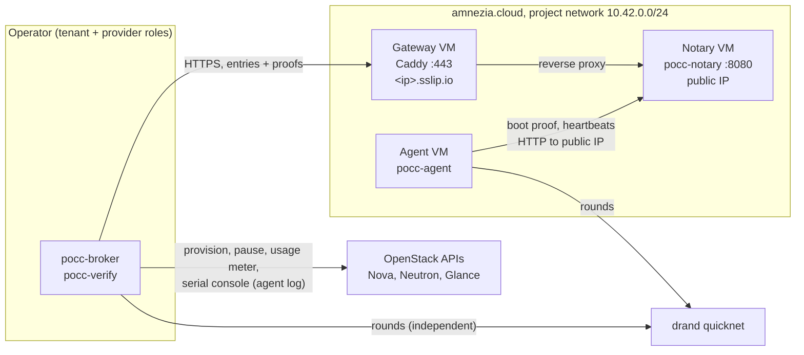

# Live test plan: Stage 0 on amnezia.cloud

Status: first run 2026-10-28, 21:00–22:00 UTC. Results are in
[`test/live/2026-10-28/`](../test/live/2026-10-28/) once the run ends.
Reproduce with [`scripts/live-test.sh`](../scripts/live-test.sh).

## Goal

Run the full PoCC cycle on a real OpenStack cloud, with the real drand beacon and a
real VM, and show three things:

1. The proof chain holds on real infrastructure: the boot proof and every heartbeat
   are anchored within the 30 s bracket.
2. The provider's own meter (Nova usage) bills more than was delivered, and PoCC
   catches it.
3. When the provider stops delivery (pauses the VM), PoCC credits nothing for the gap,
   and the tenant's policy rule refuses payment for that hour.

## Environment

| Item | Value |
|---|---|
| Cloud | amnezia.cloud, region eu-ams-1, OpenStack Nova 2025.1 (Epoxy), Intel hosts, no SEV or TDX |
| VMs | 3 × d2.cpu1ram1 (1 vCPU, 1 GB): notary, agent, HTTPS gateway |
| Image | debian-13-genericcloud-amd64-20260723, booted from a 3–5 GB volume |
| Code | each VM builds the pinned commit of this repository at first boot |
| Beacon | drand quicknet, 3 s rounds; slots every 20 rounds (60 s) |
| Anchor | dev-file anchor signed by the notary (Stage 0 development anchor) |
| Operator | a sandbox whose egress allows HTTPS to named hosts only, hence the gateway |

## Topology



The gateway exists only because the operator's network cannot reach plain HTTP.
It carries no trust: everything it relays is signed by the agent or the anchor key
and checked by the verifier.

## Timeline

| UTC | Step | Who |
|---|---|---|
| 20:51 | Network, router, notary VM, floating IP | Provider |
| 20:53 | Tenant signs request (period 21:00–22:00, rule: assurance ≥ L0 and uptime ≥ 95 %) | Tenant |
| 20:53 | Provider signs order; agent VM created | Provider |
| 20:57 | HTTPS gateway VM | Operator |
| 21:00 | Agent VM recreated so its log reaches the serial console (needed to read its key) | Provider |
| 21:02:24 | Agent boots on a slot: boot proof | Agent |
| 21:03 → 21:59 | Heartbeat every 60 s | Agent |
| ~21:30 → ~21:40 | **Scenario L3**: provider pauses the agent VM through Nova | Provider |
| 21:59:24 | Final heartbeat (next slot is past the period end) | Agent |
| after 22:00 | Receipts, verification, usage records, settlement, then delete everything | Both |

## Scenarios and expected results

| ID | Scenario | How | Expected |
|---|---|---|---|
| L1 | Proof chain on real infrastructure | Boot proof and all heartbeats, real drand, notary anchoring | No `E_BEACON`, `E_CHAIN`, `E_LOG` or `E_BRACKET` |
| L2 | Provider bills from its own meter | Receipt A: billed seconds = Nova `os-simple-tenant-usage` for the period | `INVALID` with `E_OVERBILL`: Nova counts the build time before boot and the paused time |
| L3 | Provider stops delivery | Nova `pause` for about 10 minutes mid-period | One gap; the gap and the interval across it earn nothing |
| L4 | Honest billing | Receipt B: billed seconds = credited seconds | `VALID_WITH_GAPS`, one signed usage record for 21:00–22:00 |
| L5 | Policy decides payment | Rule dry run on the usage record | `Deny`: uptime about 7,700 bp is below the 9,500 bp the tenant required |
| L6 | Settlement | `pocc-broker settle` | Receipt B: `accept`. Receipt A: would be `dispute` with `E_OVERBILL` |

Credit arithmetic for the expected values, with boot at 21:02:24, the final
heartbeat at 21:59:24 and a pause covering k missed slots:

```latex
T_{\text{credited}} = (57 - (k + 1)) \times 60\ \text{s}, \qquad
\text{uptime}_{\text{bp}} = \left\lfloor \frac{T_{\text{credited}} \times 10000}{3600} \right\rfloor
```

For k = 10: 2,760 s credited and 7,666 bp.

## Reproduce

```sh
export OS_AUTH_URL=... OS_USERNAME=... OS_PASSWORD=... OS_PROJECT_ID=... \
       OS_USER_DOMAIN_NAME=Default OS_REGION_NAME=eu-ams-1
export PERIOD_START=2026-11-02T10:00:00Z PERIOD_END=2026-11-02T11:00:00Z
scripts/live-test.sh up order agent       # at least 5 minutes before PERIOD_START
scripts/live-test.sh status               # any time
scripts/live-test.sh pause                # optional, scenario L3
scripts/live-test.sh resume
scripts/live-test.sh receipt verify       # after PERIOD_END + 1 minute
scripts/live-test.sh down
```

`STATE` (default `./live-run`) holds keys and must not be committed; copy
`live-run/results/` into `test/live/<date>/`.

## Cost

Three of the smallest VMs and up to 13 GB of volumes for about 75 minutes, plus two
floating IPs. `down` deletes all of it.

## Known limitations of this run

- The anchor is the development anchor: its timestamps are the notary's word.
  The chain anchor replaces it.
- The agent key is read from the VM's serial console. A notary endpoint that lists
  agents by server would remove that step.
- The provider and tenant roles run from one operator machine; their keys are still
  separate files.
