# Running Stage 0 on amnezia.cloud

This runbook runs one full PoCC cycle on an OpenStack project with no
confidential-computing hardware. Every step names who performs it.

```mermaid
flowchart LR
    K["1 keygen<br/>tenant, provider, meter"] --> NS["2 netsetup<br/>network, router, notary port"]
    NS --> NV["3 notary VM<br/>+ floating IP"]
    NV --> RQ["4 request<br/>tenant signs policy"]
    RQ --> OR["5 order<br/>provider signs"]
    OR --> AV["6 agent VM<br/>boot proof, heartbeats"]
    AV --> RC["7 receipt<br/>provider"]
    RC --> VF["8 verify<br/>tenant, usage records"]
    VF --> ST["9 settle<br/>tenant"]
```



## Prerequisites

- Go 1.24 or later on the operator's machine: `go build -o bin/ ./cmd/...`
- OpenStack credentials in the environment (from Horizon, *API Access → OpenStack RC file*):
  `OS_AUTH_URL`, `OS_USERNAME`, `OS_PASSWORD`, `OS_PROJECT_ID`, `OS_USER_DOMAIN_NAME`, `OS_REGION_NAME`.
- Quota for two small VMs (1 vCPU, 1 GB each), two 5 GB volumes and one floating IP.

The VMs build their binary from a pinned commit of this repository at first boot,
so nothing has to be uploaded. Pass the commit with `-ref`.

## Steps

```sh
# 1. Keys (tenant, provider, meter). Keep key files out of git.
bin/pocc-broker keygen -out tenant.json
bin/pocc-broker keygen -out provider.json
bin/pocc-broker keygen -out meter.json          # prints signing_pub: the policy's meter key

# 2. Provider: network, router to the external network, and a security group for the notary.
bin/pocc-broker netsetup                        # prints the network ID

# 3. Provider: notary VM with a public address.
NOTARY=$(bin/pocc-broker provision -role notary -image <debian-13 image ID> -network <net ID> -ref <commit>)
bin/pocc-broker fip -server $NOTARY             # prints the floating IP; wait ~3 min for the build
curl http://<floating IP>:8080/v0/info          # returns the dev anchor key

# 4. Tenant: request with the Warrant rent policy.
bin/pocc-broker request -keys tenant.json -image <image ID> -flavor d2.cpu1ram1 \
  -start 2026-11-02T09:00:00Z -end 2026-11-02T17:00:00Z -price 1100 \
  -meter-pub <meter signing_pub> -chain-id <escrow chain> -vault <escrow> -token <token>

# 5. Provider: order.
bin/pocc-broker order -request request.json -keys provider.json \
  -notary http://<floating IP>:8080 -anchor-key <anchor key>

# 6. Provider: agent VM. It must use the flavor and image in the request.
SERVER=$(bin/pocc-broker provision -role agent -image <image ID> -network <net ID> -ref <commit>)

# 7. Provider, after the period: receipt (billed seconds default to Nova's own usage meter).
curl "http://<floating IP>:8080/v0/entries?agent=..."   # the agent key is in entry seq 0
bin/pocc-broker receipt -agent <agent key> -server $SERVER

# 8. Tenant: verify and sign hourly usage records with the meter key.
bin/pocc-verify -receipt receipt.json -anchor-key <anchor key> -out verdict.json \
  -notary http://<floating IP>:8080 -meter-keys meter.json

# 9. Tenant: accept or dispute.
bin/pocc-broker settle
```

## Costs to expect

Two of the smallest VMs, two 5 GB volumes and one floating IP for the length of the
period. Delete both servers afterwards; their volumes are deleted with them.
