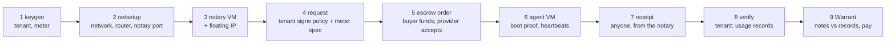

# Running Stage 0 on amnezia.cloud

This runbook runs one full PoCC cycle on an OpenStack project with no
confidential-computing hardware. Every step names who performs it.



## Prerequisites

- Go 1.24 or later on the operator's machine: `go build -o bin/ ./cmd/...`
- OpenStack credentials in the environment (from Horizon, *API Access → OpenStack RC file*):
  `OS_AUTH_URL`, `OS_USERNAME`, `OS_PASSWORD`, `OS_PROJECT_ID`, `OS_USER_DOMAIN_NAME`, `OS_REGION_NAME`.
- Quota for two small VMs (1 vCPU, 1 GB each), two 5 GB volumes and one floating IP.
- An escrow order on the chain the policy names (decision 23). Until Warrant's rent
  case exists (PE-2), use dev placeholders for the escrow address, order id and policy
  hash: the binding is real, the escrow is not.

The VMs build their binary from a pinned commit of this repository at first boot,
so nothing has to be uploaded. Pass the commit with `-ref`.

`scripts/live-test.sh` runs these steps as phases; `docs/live-test-plan.md` is the
plan it follows.

## Steps

```sh
# 1. Keys (tenant, meter). Keep key files out of git.
bin/pocc-broker keygen -out tenant.json
bin/pocc-broker keygen -out meter.json          # prints signing_pub: the policy's meter key

# 2. Provider: network, router to the external network, and a security group for the notary.
bin/pocc-broker netsetup                        # prints the network ID

# 3. Provider: notary VM with a public address.
NOTARY=$(bin/pocc-broker provision -role notary -image <debian-13 image ID> -network <net ID> -ref <commit>)
bin/pocc-broker fip -server $NOTARY             # prints the floating IP; wait ~3 min for the build
curl http://<floating IP>:8080/v0/info          # returns the dev anchor key

# 4. Tenant: request carrying the meter spec and the Warrant rent policy.
#    policy_hash comes from `warrant-policy hash policy.json` (dev placeholder until PE-2).
bin/pocc-broker request -keys tenant.json -image <image ID> -flavor d2.cpu1ram1 \
  -start 2026-11-02T09:00:00Z -end 2026-11-02T17:00:00Z -price 1100 \
  -notary http://<notary private IP>:8080 -anchor-key <anchor key> \
  -policy-hash <hex> -meter-key <meter signing_pub> \
  -chain-id 5042002 -vault <escrow> -token 0x3600000000000000000000000000000000000000
# (or -policy policy.json to carry an approved policy as is)

# 5. Buyer funds the escrow order (offer); provider accepts (accept(orderId)).
#    The order id comes from the chain.

# 6. Provider: agent VM bound to the escrow order. Flavor and image must match the request.
SERVER=$(bin/pocc-broker provision -role agent -image <image ID> -network <net ID> -ref <commit> \
  -request request.json -escrow-chain-id 5042002 -escrow <escrow> -escrow-order-id <orderId>)

# 7. After the period, anyone: receipt from the notary's log. No bill, no signature.
#    -keys tenant.json discloses the final usage counters (the seed is sealed to the tenant).
curl "http://<floating IP>:8080/v0/entries?agent=..."   # the agent key is in entry seq 0
bin/pocc-broker receipt -request request.json -agent <agent key> -server $SERVER -keys tenant.json \
  -escrow-chain-id 5042002 -escrow <escrow> -escrow-order-id <orderId>

# 8. Tenant: verify; write PoCC-native and Warrant usage records; sign the Warrant ones
#    with Warrant's tool (PE-3).
bin/pocc-verify -receipt receipt.json -anchor-key <anchor key> -out verdict.json \
  -notary http://<floating IP>:8080 -meter-keys meter.json \
  -warrant-records warrant-records.json \
  -warrant-sign-cmd "warrant-evidence sign-usage {key} {in} {out}" -warrant-sign-key meter.key

# 9. Warrant: the provider's notes are checked against the records (gates D1-D7); the
#    escrow pays proven hours. Nothing to run in PoCC.
```

## Costs to expect

Two of the smallest VMs, two 5 GB volumes and one floating IP for the length of the
period. Delete both servers afterwards; their volumes are deleted with them.
