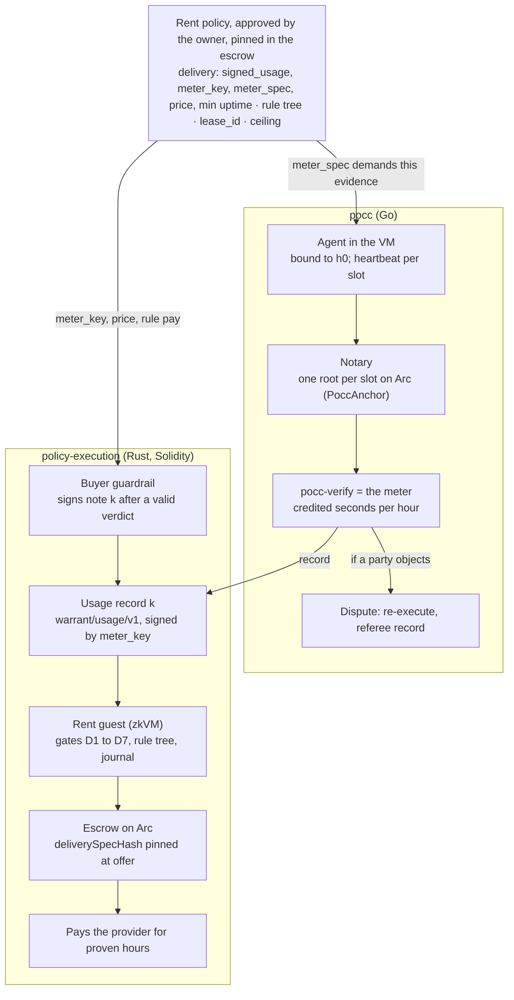

# PoCC × Warrant integration — Spec v0.1

Status: v0.1 reviewed by the owner on 2026-10-29; decisions D-A to D-H taken (see
`docs/decisions.md`, entries 15–25). The owner's review notes and the answers are in
the Claude doc "Proof of Cloud Compute (PoCC) — PoC spec", tab "Warrant integration
v0.1".

PoCC becomes the meter of Warrant's rent case: the tenant's policy names the PoCC
verifier as `meter_key`, the verifier turns anchored heartbeats into signed usage
records, and Warrant's guest and escrow pay only for the seconds those records prove.
The change to Warrant is one delivery kind, `signed_usage`, which its framework
design already plans; the change to PoCC is to emit Warrant-native records and to
anchor on Arc.

Sources: policy-execution `docs/framework.md`, `docs/handoff/03-rent-case.md`,
`docs/product/lease-evidence.md`, `core/src/lib.rs` (commit `5817e34`); warrant
`hardware-purchase/spec.md`; this repository's `docs/architecture.md`.

## 1. Summary

Warrant's rent case has a hole that its own handoff names: "No honest meter exists
yet. The delivery proof is only as good as the meter key." PoCC fills it. The meter
becomes a deterministic program over evidence that nobody controls alone:
agent-signed heartbeats, drand randomness and Arc block times. Anyone who re-runs
`pocc verify` on the receipt gets the same usage record, so the meter key attests a
computation, not an opinion.

**Proposed answer to Decision 6 (who runs the meter).** The buyer runs it. The meter
key in the policy is the buyer's own PoCC verifier key. This is safe for the buyer
because the verifier can only credit seconds that the provider's VM proved and the
notary anchored, and safe for the seller because the verifier is public code over
public inputs, so a buyer who under-credits can be shown wrong by anyone re-running
it. Later, when the verifier runs inside Warrant's guest, the delivery kind becomes
`computed_result` and the meter key disappears.

| Repository | Change | Size |
|---|---|---|
| policy-execution | Rent case (`core/src/meter.rs`) gains the `signed_usage` delivery check with a `UsageRecord` struct and a `meter_spec` hash; the delivery section carries `min_uptime_bp`; `warrant-evidence sign-usage` | Framework step 8 as planned, plus two fields |
| pocc | Verifier emits Warrant-shaped usage records; broker answers the per-hour challenge with a note; notary anchors on Arc; policy section matches Warrant's typed struct | Medium |
| warrant | Compute-rent use case spec: answers the open point "who confirms delivery" for hosted services; marketplace (warrant#13) consumes it | Docs |

Nothing in Warrant's invariants moves: fields that select (keys, addresses, scope)
come from the owner-approved policy; the delivery check runs before the rule tree and
cannot be bypassed; only a proof pays.

## 2. At a glance



The policy at the top is the contract between the two halves. Its `meter_spec` tells
PoCC what evidence to produce; its `meter_key`, price and rule tell Warrant what to pay
on. The usage record is the only object that moves from left to right, and a dispute is
the only thing that moves back.

## 3. Vocabulary and crypto mapping

Everything Warrant verifies is Warrant-native (secp256k1, bincode, `warrant/*` tags);
everything PoCC verifies stays PoCC-native (Ed25519, JCS, `PoCC/*` tags). The usage
record is the only object that crosses the line, and it is Warrant-native.

| Concept | PoCC | Warrant | Mapping |
|---|---|---|---|
| Buyer | Tenant | Customer, owner of the policy, funder of the order | Same party |
| Seller | Provider | Vendor, recipient | Same party |
| Unit of delivery | Credited seconds per clock hour | A "piece" with a note per piece | One piece = one billing hour k |
| Delivery evidence | Receipt (boot proof, heartbeats, anchors) | Usage record signed by `meter_key` | `pocc verify` produces the record from the receipt |
| Buyer's consent to pay for a piece | Settlement (accept) | Note: `Acceptance` signed by the acceptance key, `task_id = note_id(lease_id, k)` | The guardrail signs note k only after a verdict for hour k that is not INVALID |
| Policy | `RentPolicy` carried in the Request | Typed rent policy, hashed with `warrant/policy/v1` over bincode | PoCC carries the exact JSON Warrant approved; it reads only `delivery` |
| Policy hash | — | `policy_hash` from `warrant-host hash` | PoCC stores it in the Request; never recomputes it |
| Meter parameters | `delivery.pocc` object | `meter_spec: Hash` inside the delivery section | `meter_spec = H("PoCC/poc/meter-spec", JCS(delivery.pocc))` |
| Lease | Order ID | `lease_id` (= `poId` on chain) | `lease_id = H("PoCC/poc/lease", request_hash)` |
| Obligation | — | `obligation_id(lease_id, batch)` | One batch = one settlement |
| Signing keys | Ed25519 (tenant, provider, agent, meter) | secp256k1 SEC1 compressed, low-S ECDSA | Meter, acceptance and registry keys are secp256k1; PoCC keeps Ed25519 for its own artifacts |
| Hashing | SHA-256 over length-prefixed parts, ASCII tags | SHA-256 over `tagged_bytes` (u64 LE lengths, bincode) | Not shared; each side hashes its own objects |
| Time | drand rounds, anchor block time | Block time on Arc for windows and `settleBy` | The anchor chain is Arc, so both read the same clock |
| Chain | Dev anchor today | Arc testnet 5042002, mainnet 5042; gas in USDC | PoCC notary posts roots to Arc |

**Key inventory after integration (decisions 24, 25).** The buyer holds two keys: the
wallet (funds orders) and the guardrail key (secp256k1), which fills the registry,
acceptance and meter roles in v1 and signs the Request through `warrant-evidence`. The
policy keeps the three role fields so they can diverge later. The provider holds its
payout key. An Ed25519 key is born and dies inside each VM (the agent), and the notary
holds the dev anchor key until the Arc anchor replaces it. Warrant-specific code in
PoCC lives in one adapter package, `pkg/adapter/warrant`, which turns a verdict into
Warrant's usage record; PoCC's core artifacts stay consumer-agnostic, so another escrow
or a billing system gets its own adapter.

**Alternatives to the buyer as the meter, and a malicious buyer.** Four other parties
could hold `meter_key`: the provider (the party being paid, which defeats the purpose),
an independent metering service (a new entity; later, as a referee), buyer and provider
co-signing (both online every hour, no gain over the buyer alone), or the zkVM guest
(`computed_result`, the end state X-1). A malicious buyer can only under-credit: sign
records for fewer seconds than the receipt proves, or sign nothing. It cannot
over-credit without paying itself, cannot move funds, and cannot forge the provider's
evidence. The provider's exposure is one hour, because it challenges for hour k before
serving hour k+1 and stops when a record or note is missing; and anyone can re-run
`pocc verify` on the public evidence and show the under-credit.

## 4. The rent policy

The policy follows Warrant's "one DSL shape" (framework section 8). Its delivery
section stays meter-agnostic: Warrant's typed struct holds the meter key, the price and
the uptime floor, plus one hash that pins the meter's own parameters. PoCC's parameters
live outside Warrant's types, so adding a beacon or a slot length never changes a
Warrant struct.

**Typed delivery section (policy-execution, `core/src/framework`)**

```rust
// DeliverySpec::SignedUsage, hashed with tag warrant/delivery/v1 -> deliverySpecHash
pub struct SignedUsage {
    pub meter_key: Vec<u8>,     // SEC1 compressed secp256k1; the owner approves it
    pub unit: u16,              // 1 = instance-second, 2 = gpu-second (table in core)
    pub price_per_unit: u64,    // token base units per unit
    pub tolerance: u64,         // token base units a note may exceed units*price
    pub min_uptime_bp: u16,     // Deny a record below this share of its window
    pub min_assurance: u8,      // 0 = L0 (no TEE), 1 = L1 (SEV-SNP)
    pub meter_spec: Hash,       // hash of the meter's parameter document
}
```

`min_uptime_bp` and `min_assurance` sit in the delivery check, not in the rule tree, so
the Verus-proved evaluator and the `Rule` enum do not change. Rule atoms for them can
follow after framework step 5.

**PoCC parameter document** (the `pocc` object; `meter_spec` is its JCS hash under
`PoCC/poc/meter-spec`):

```json
{
  "format": "poc-0.2",
  "attestation": "none",
  "allowed_image": "2d8c6a76-dc42-41f9-82ad-1a9dc278de8e",
  "flavor": "d2.cpu1ram1",
  "beacon_chain_hash": "52db9ba70e0cc0f6eaf7803dd07447a1f5477735fd3f661792ba94600c84e971",
  "slot_rounds": 20,
  "bracket_s": 30,
  "anchor": {"kind": "evm", "chain_id": 5042002, "contract": "<PoccAnchor>"}
}
```

**Policy as the owner approves it** (Warrant JSON; PoCC carries these bytes unchanged
inside the Request together with `policy_hash` from `warrant-host hash`):

```json
{
  "case": "rent",
  "version": 1,
  "scope": {"chain_id": 5042002, "vault": "<ProofInvoiceEscrow>", "token": "0x3600000000000000000000000000000000000000"},
  "validity": {"after": 1794819600, "until": 1795424400},
  "customer": "<buyer wallet>",
  "registry_key": "<secp256k1>",
  "acceptance_key": "<secp256k1, signs notes>",
  "lease_id": "<H(PoCC/poc/lease, request_hash)>",
  "ceiling": 50000000,
  "max_note": 4000000,
  "batch_size": 24,
  "delivery": {
    "kind": "signed_usage",
    "meter_key": "<secp256k1, the buyer's pocc-verify key>",
    "unit": 1,
    "price_per_unit": 1100,
    "tolerance": 0,
    "min_uptime_bp": 9500,
    "min_assurance": 0,
    "meter_spec": "<hash of the pocc object>"
  },
  "rule": {"all": ["accepted", {"amount_at_most": 4000000}, {"vendor_category_in": [12]}]}
}
```

Amounts are USDC base units (six decimals): 1100 per second is 3.96 USDC per hour, and
`max_note` caps one hour at 4 USDC.

**What each side checks.** Warrant's validator rejects a rent policy without a
`delivery` section of kind `signed_usage`, with a zero `meter_spec`, or with
`min_uptime_bp` above 10000. PoCC's verifier recomputes `meter_spec` from the `pocc`
object in the Request and compares it with the policy's; on mismatch it reports
`E_POLICY` and signs no record.

## 5. Identifiers

One lease ties the PoCC order, the escrow order, the notes and the usage records
together. It is derived from the tenant-signed Request, so it exists before either
order and both can carry it.

| Identifier | Definition | Appears in |
|---|---|---|
| `request_hash` | `H(PoCC/poc/request, JCS(request))` | `lease_id` derivation |
| `lease_id` | `H(PoCC/poc/lease, request_hash)`, 32 bytes | Policy (`lease_id`), escrow order (`poId`), notes, usage records |
| `policy_hash` | Warrant: `hash_tagged(warrant/policy/v1, policy)` | Request (copied), escrow order, journal |
| `deliverySpecHash` | Warrant: hash of the typed delivery section | Escrow order at `offer`, journal |
| `h0` | `H(PoCC/poc/order, policy_hash, lease_id, chain_id, escrow, orderId)` | Boot proof e0, every heartbeat |
| `orderId` (chain) | `keccak256(chainId, escrow, customer, policyHash, lease_id)` | Escrow |
| `note_id(lease_id, k)` | `hash_tagged(warrant/note/v1, (lease_id, k))`; k = hour index from the period start | Note `task_id` |
| `obligation_id(lease_id, b)` | `hash_tagged(warrant/obligation/v1, (lease_id, b))`; batch b = hours `b*batch_size` onward | Request `task_id`, journal |
| `receipt_hash` | `H(PoCC/poc/receipt, JCS(receipt))` | Usage record `deliverable_hash` |

**One order (decision 23).** The escrow order is the order. It carries `policyHash`,
`deliverySpecHash`, `lease_id`, the ceiling and the deadlines, and the provider's
`accept(orderId)` is its acceptance. Everything the standalone PoCC Order used to carry
has a home: the rate is `price_per_unit` in the policy; beacon, slot, bracket and
anchor are in `meter_spec`; the notary address sits in the `pocc` object. The boot
binding is derived from the escrow order:

```latex
h_0 = H(\texttt{PoCC/poc/order} \,\|\, \text{policy\_hash} \,\|\, \text{lease\_id} \,\|\, \text{chain\_id} \,\|\, \text{escrow} \,\|\, \text{orderId})
```

The agent reads the five values from the config drive; the verifier recomputes `h0`
from the policy and the chain and refuses any other. The standalone PoCC Order remains
only as the offline mode for running PoCC without an escrow (the Stage 0 demo).

**Hour index.** Hour k covers `[period.start + k*3600, period.start + (k+1)*3600)`. The
period start is aligned to a clock hour by the broker so that PoCC's per-hour credit
and Warrant's notes count the same hours.

## 6. The proof path, as the policy states it

The policy is the whole proving path written down in advance. Every piece of evidence
that the path produces is demanded by a field of the policy, and every check that
consumes it reads that field. Nothing on the path is decided by a party at run time.

### 6.1 What the DSL demands

| Layer | Policy fields | What it demands |
|---|---|---|
| Who may attest delivery | `delivery.kind = signed_usage`, `meter_key` | Only a usage record signed by this key counts as delivery. No record: `Ask`. Wrong key: `Deny`. |
| What the attestation must have been computed from | `meter_spec` | The record is valid only for a receipt whose evidence matches the pinned PoCC parameters: image, flavor, beacon, slot, bracket, anchor contract, attestation level. The verifier refuses to sign otherwise. |
| What the attested delivery must satisfy | `price_per_unit`, `tolerance`, `min_uptime_bp`, `min_assurance`, and the `rule` tree | Billed amount at most `units × price + tolerance`; uptime and assurance floors; the owner's spending rules on top. |

A policy without the first two layers is rejected by Warrant's validator, so a rent
policy cannot exist without a delivery proof.

### 6.2 The path, step by step

| # | Step | Demanded by | Produces | Checked by |
|---|---|---|---|---|
| 1 | Owner approves the policy; `policy_hash` and `deliverySpecHash` are computed | — | Policy JSON, two hashes | `warrant-host hash`; the buyer's own review |
| 2 | Tenant signs the Request carrying the policy and `policy_hash` | — | Request, `request_hash`, `lease_id` | Provider (before order), PoCC verifier |
| 3 | Buyer funds the escrow order: `offer(policyHash, deliverySpecHash, lease_id, ceiling, deadlines)` | `scope`, `ceiling`, `validity` | Escrow order | Escrow stores both hashes; nothing settles against other values |
| 4 | Provider calls `accept(orderId)` and boots the VM with `h0` derived from the escrow order | `meter_spec.flavor`, `allowed_image`, `lease_id` | `h0` | PoCC verifier recomputes `h0` from the policy and the chain: `E_BIND` on any other value |
| 5 | Agent binds to `h0` at boot and signs a heartbeat on every slot | `meter_spec.slot_rounds`, `beacon_chain_hash`, `attestation` | Boot proof, heartbeats | PoCC verifier |
| 6 | Notary anchors one root per slot on Arc | `meter_spec.anchor`, `bracket_s` | Batch proofs with block times | PoCC verifier: `E_LOG`, late entries earn nothing |
| 7 | After hour k, provider assembles the receipt so far and presents it with a 402 challenge for note k | `max_note` | Receipt | — |
| 8 | Buyer's guardrail runs `pocc verify` (the meter) on the receipt | `meter_key`, `meter_spec` | Verdict; usage record k signed by `meter_key` | The guardrail signs only on a verdict that is not `INVALID` |
| 9 | Guardrail signs note k for `min(max_note, units_k × price)` | `acceptance_key`, `max_note` | Note k | Provider's service, natively, before serving hour k+1 |
| 10 | Provider's worker batches notes and records, proves with the rent guest | `batch_size`, all of `delivery`, `rule` | Journal with `deliverySpecHash`, `deliveryHash` | Guest (section 7) |
| 11 | Worker calls `settle(seal, journal)` | `scope`, `ceiling` | Payment to the recipient | Escrow: image ID, `schemaId`, both hashes, obligation consumed once |
| 12 | After `settleBy`, anyone closes; the remainder returns | `validity` | — | Escrow |

### 6.3 Why the path cannot be shortened

Step 11 pays only for a journal that commits `deliverySpecHash` equal to the order's;
the journal exists only if step 10 found records under `meter_key` for every hour in
the batch; the verifier signs a record only for a receipt whose evidence matches
`meter_spec`; and that evidence exists only if the VM ran the agent bound to `h0`. The
chain of "only if" runs from the escrow back to the tenant's signed policy with no step
that a single party can supply alone.

## 7. The usage record and the delivery check in the guest

The usage record is the one object that crosses from PoCC into Warrant. It is a
Warrant-typed struct, bincode-encoded, signed by the meter key over
`tagged_bytes(warrant/usage/v1, record)`, so it can never be mistaken for a note.

```rust
// core/src/meter.rs
pub struct UsageRecord {
    pub scope: Scope,            // chain, escrow, token: equal to the policy's
    pub lease_id: Hash,
    pub first_index: u32,        // hour index k
    pub last_index: u32,         // = k for PoCC; a range is allowed by the type
    pub window_start: u64,       // unix seconds, the clock hour
    pub window_end: u64,
    pub units: u64,              // credited seconds in the window
    pub assurance: u8,           // 0 = L0, 1 = L1
    pub meter_spec: Hash,        // the meter_spec the verifier checked against
    pub deliverable_hash: Hash,  // PoCC receipt_hash: the evidence the record was computed from
}
```

`pocc-verify` writes this struct as JSON; `warrant-evidence sign-usage <meter.key>
usage.json sig.json` signs it, mirroring `sign-acceptance`. PoCC never implements
bincode or secp256k1.

**Gates in `authorize_meter`, after the nine existing checks** (a removed-check test per
gate, as acceptance ME-1 requires):

| # | Gate | Outcome if it fails |
|---|---|---|
| D1 | A record exists for every note index in the batch, with no gap and no overlap | `Ask` (missing), `Deny` (overlap) |
| D2 | Each record's signature verifies under `delivery.meter_key` | `Deny` |
| D3 | Each record's `scope` and `lease_id` equal the policy's; `meter_spec` equals `delivery.meter_spec` | `Deny` |
| D4 | Each record's window lies inside the policy's validity, and `window_end - window_start` is one hour | `Deny` |
| D5 | For each note k: `amount_k ≤ units_k × price_per_unit + tolerance` | `Deny` |
| D6 | `units_k × 10000 / (window_end - window_start) ≥ min_uptime_bp` | `Deny` |
| D7 | `assurance ≥ min_assurance` | `Deny` |

Then the rule tree runs on the existing facts. The journal is the invoice layout plus
the two delivery words: `deliverySpecHash` and
`deliveryHash = hash_tagged(warrant/usage-batch/v1, records in index order)`.

**What the guest proves and does not prove.** It proves that the key the owner named
signed records for every hour billed, that those records were computed against the
pinned meter parameters, and that no hour was billed above its credited seconds. It
does not prove that the verifier ran correctly: that is the meter-key trust assumption,
bounded by the fact that anyone can re-run the verifier on the receipt named in
`deliverable_hash` (section 8). Moving the verifier into the guest removes the
assumption; it is the last work package.

## 8. Dispute

Not in the first implementation (decision 20): v1 ends a disagreement where Warrant
ends it today, with `Ask` to the owner and the hour unpaid. The design below is kept
for the phase that adds it.

A dispute is a signed claim by one party that the proving path produced a wrong result
for a named hour, together with the evidence a referee needs to re-run that hour.
Because every step of the path is deterministic over public inputs, a referee does not
weigh testimony: it re-executes and publishes what it gets. Warrant's design has no
dispute entity today; its proof-only escrow pays or refuses. The entity below sits
beside the escrow, never inside it, and ends in one of the escrow's existing moves.

### 8.1 What can be disputed and what cannot

| Situation | Who raises it | Disputable? | Why |
|---|---|---|---|
| Verifier credited fewer seconds than the provider believes it delivered (gap, late anchors) | Provider | Yes | The receipt and the anchors decide; a referee re-runs the verifier |
| Verifier credited seconds the tenant believes were not delivered | Tenant | Yes | Same evidence; the tenant may also open usage fields |
| Guardrail does not answer the hourly challenge (no note, no record) | Provider | Yes, as non-cooperation | The provider stops service; the escrow returns the remainder after `settleBy`; the record of it feeds reputation |
| Provider's receipt omits anchored entries | Tenant | Yes | The notary's log and Arc hold the entries; a referee rebuilds the receipt |
| Overbilling (`E_OVERBILL`), forged or replayed heartbeats, wrong image | — | No | Not paid by construction; nothing to resolve |
| Unanchored heartbeats (notary down or hostile) | Provider | No | Delivery is defined as anchored delivery; the provider chooses and can run its notary |
| VM slow or unresponsive while heartbeats continue | Tenant | No, in Stage 0 | PoCC proves liveness, not performance; Stage 1 spot checks address it |

### 8.2 The dispute object

```json
{
  "pocc": "poc-0.2",
  "dispute_id": "<H(PoCC/poc/dispute, claimant_key, lease_id, hour)>",
  "lease_id": "…",
  "hour": 21,
  "claimant": "tenant | provider",
  "claim": "UNDERCREDIT | OVERCREDIT | OMITTED_ENTRIES | NO_COOPERATION",
  "receipt_hash": "…",
  "verdict_hash": "…",
  "expected": {"credited_s": 3600},
  "evidence": ["<receipt URL or hash>", "<notary entries URL>", "<Arc anchor txs>"],
  "opened_at": 1794830000,
  "sig": "<claimant's PoCC key>"
}
```

The object is anchored like a heartbeat (its hash goes into the next notary batch), so
the time it was opened is fixed and it cannot be withdrawn silently.

### 8.3 Resolution procedure

1. **Open.** The claimant signs and anchors the dispute within the policy's dispute
   window (`validity.until`; 7 days after the period in the example policy). Hours
   without an open dispute settle as section 6 describes.
2. **Freeze.** The hour in dispute is left out of the provider's next batch, so
   settlement of undisputed hours continues. Warrant's `Ask` outcome for a missing
   record covers the same case: the batch excludes the hour rather than waiting.
3. **Re-execute.** A referee runs `pocc verify` on the receipt named in the dispute,
   with its own drand and Arc access. In Stage 0 the referee is any third party both
   sides accept in the policy (`referee_key`); in Stage 1 it is Warrant's guest running
   the verifier as a `computed_result`, and the chain is the referee.
4. **Decide.** The referee signs a resolution: the verdict it obtained, the credited
   seconds for the hour, and one of `PAY_AS_VERIFIED`, `PAY_AS_CLAIMED`, `NO_PAYMENT`,
   `ESCALATE`. `PAY_AS_CLAIMED` is possible only when the referee's own run gives the
   claimed value (for example, the tenant's guardrail ran a stale verifier).
5. **Execute.** On `PAY_*`, the referee's usage record for the hour, signed by the
   `referee_key` named in the policy, replaces the missing one; the provider includes
   the hour in a later batch, and the guest accepts a record under either `meter_key`
   or `referee_key` for a disputed hour. On `NO_PAYMENT`, the hour stays out. On
   `ESCALATE`, the owner decides through Warrant's existing `Ask` inbox, and the
   escrow's `settleApproved` path (where the deployment keeps it) or a manual payment
   outside the escrow settles it.
6. **Record.** The dispute, the resolution and the outcome are anchored and fed to
   Mnemonik's reputation records for both parties, as Warrant's hardware-purchase spec
   already plans for settlement events.

### 8.4 Bounds

A dispute never blocks undisputed hours, never moves funds by itself, and never
outlives `settleBy`: after it, the remainder returns to the buyer and an unresolved
dispute becomes a reputation fact only. The provider's exposure is bounded to the hours
it delivered after the last note; the tenant's to the ceiling. Non-cooperation is
symmetric: a tenant that stops answering challenges loses the service, a provider that
stops serving loses the hours.

### 8.5 Policy fields the dispute needs

| Field | Where | Meaning |
|---|---|---|
| `referee_key` | `delivery` section, optional | A secp256k1 key whose usage records are accepted for disputed hours only |
| `dispute_window_s` | `delivery` section | How long after an hour a dispute can be opened; must end before `settleBy` minus the proving margin |
| `disputed` flag | Usage record | Set on referee-signed records so the guest applies the `referee_key` rule only there |

Without `referee_key`, steps 3 to 5 reduce to `ESCALATE`, which is Warrant's `Ask`
today.

## 9. Anchoring on Arc

The notary posts one Merkle root per 60 s slot to a contract on the chain the escrow
lives on, so the verifier reads heartbeat times and the escrow reads `settleBy` from
the same clock. The dev-file anchor used in the live test is replaced; nothing else in
the notary changes.

```solidity
// PoccAnchor.sol: no owner, no upgrade, no fee logic
contract PoccAnchor {
    mapping(bytes32 => uint64) public anchoredAt;   // root -> block.timestamp
    event Anchored(bytes32 indexed root, uint64 slot, address indexed notary);
    function anchor(bytes32 root, uint64 slot) external {
        require(anchoredAt[root] == 0, "anchored");
        anchoredAt[root] = uint64(block.timestamp);
        emit Anchored(root, slot, msg.sender);
    }
}
```

| Item | Value |
|---|---|
| `AnchorRef.kind` | `evm` |
| `AnchorRef.ref` | transaction hash |
| `AnchorRef.time` | the block timestamp; the verifier re-reads it with `eth_getTransactionReceipt` and `eth_getBlockByNumber`, and checks the log's root |
| Policy pin | `meter_spec.anchor = {chain_id, contract}`; a root on another contract is `E_LOG` |
| Cost | 1,440 transactions per day for the whole cloud, paid by the provider as a cost of selling (decision 21); at an assumed 0.01 USDC per transaction, 14.40 USDC a day, under 1 % of a 3.96 USDC hour across 100 VMs. The Arc gas price is measured in phase D. Cheaper variants: anchor every 5 min with `bracket_s` raised to match, or one Mnemonik-run notary for many providers charging per root |
| Finality | The verifier treats a block as final after the depth the policy names (`anchor.confirmations`, default 1 on Arc testnet) |
| Notary identity | Any address may anchor; the root, not the sender, carries trust |

The notary's `anchors.jsonl` file remains as a local cache. A verifier offline from Arc
can run with the cached times and report assurance `L0-unanchored`, which the guardrail
must refuse to sign records for.

## 10. Work packages

One pull request per package, as the policy-execution handoff requires. Packages in
policy-execution follow its rules: no renames, Simplified Technical English, no
widening of the Verus claim, golden vectors changed only on purpose.

### policy-execution

| ID | Package | Depends on | Acceptance |
|---|---|---|---|
| PE-1 | Spec update: `docs/product/lease-evidence.md` and `docs/handoff/03-rent-case.md` state the PoCC meter, the `UsageRecord` of section 7, `meter_spec`, `min_uptime_bp`, `min_assurance`, `referee_key`, and the trust table row for the meter key. Answers Decision 6 | — | Owner approves; DL-5 (trust table names the meter key and its failure mode) |
| PE-2 | `SignedUsage` delivery spec and `deliverySpecHash` in `core/src/framework` | Framework step 1 | A policy without `delivery` or with zero `meter_spec` is rejected; hash pinned in a test |
| PE-3 | `core/src/meter.rs`: `UsageRecord`, `usage_message` (`warrant/usage/v1`), gates D1–D7 in `authorize_meter`, `deliveryHash` | PE-2, framework step 2 (journal v2) | DL-1 to DL-3; a removed-check test per gate; fixtures from the PoCC live-test receipt |
| PE-4 | `warrant-evidence sign-usage`, `warrant-host check rent` | PE-3 | Signs the JSON `pocc-verify` writes; the native check equals the guest's on the fixtures |
| PE-5 | Rent guest image; `prove rent`, `image-id rent` | PE-3, framework step 4 | Image ID from a `RISC0_USE_DOCKER=1` build recorded (ME-5); ME-2 journal mutation test |
| PE-6 | Escrow: `deliverySpecHash` check at `settle`; `PoccAnchor.sol` beside the escrow contracts | Framework step 3, decision on #19 | DL-4; `forge test` on a machine with Foundry |
| PE-7 | `templates/rent-pocc-v1.json` | PE-2 | Validates against the schema; policy hash pinned |

### pocc

| ID | Package | Depends on | Acceptance |
|---|---|---|---|
| PC-1 | Policy section matches section 4: `meter_spec` computed and checked; `policy_hash` and `lease_id` carried; `h0` derived from the escrow order; period aligned to clock hours; Warrant code isolated in `pkg/adapter/warrant` | — | `E_POLICY` tests for each pinned field; simulated T1 still passes |
| PC-2 | `pocc-verify` writes Warrant `UsageRecord` JSON per hour (section 7 fields) and calls `warrant-evidence sign-usage` when given a meter key file | PE-4 for signing; JSON shape from PE-3 | Record for the live-test hour round-trips through `warrant-host check rent` |
| PC-3 | Hourly challenge: `pocc-broker challenge` (provider) emits a 402-style challenge with the receipt so far; `pocc-broker answer` (buyer guardrail) verifies, signs the record and the note | PC-2 | Simulated 8-hour run yields 8 notes and 8 records; an hour with `INVALID` yields neither |
| PC-4 | Arc anchor: `anchor/evm.go` posts roots to `PoccAnchor` and verifies them from receipts; `AnchorRef.kind = evm` | PE-6 (contract) | Live run on Arc testnet with 1,440 anchors a day under budget; verifier reads times from the chain only |
| PC-5 (future) | Dispute object, `pocc-broker dispute open|resolve`, referee re-execution, anchoring of disputes | PC-3 | Simulated UNDERCREDIT and OMITTED_ENTRIES disputes resolve to the re-executed value |
| PC-6 | Batch builder: `pocc-broker batch` assembles `MeterInput` JSON (notes, records, credential) for `warrant-host prove rent` | PE-4, PC-3 | A batch proves and settles on Arc testnet (ME-3 for a PoCC batch) |

### warrant

| ID | Package | Depends on | Acceptance |
|---|---|---|---|
| W-1 | `compute-rent/spec.md`: the use case, the proving path of section 6, the dispute of section 8; closes open point 1 of `hardware-purchase/spec.md` ("who confirms delivery") for hosted services | PE-1 | Owner approves |
| W-2 | Marketplace (warrant#13) lists PoCC-metered VMs: the listing carries `meter_spec` and the image measurement | W-1 | A listing round-trips into a policy |
| W-3 | Add `pocc` as a submodule beside `policy-execution` | — | README links it |

### Last package, both repositories

| ID | Package | Depends on | Acceptance |
|---|---|---|---|
| X-1 | The PoCC verifier runs inside the rent guest as a `computed_result` delivery check: the guest takes the receipt, re-derives credited seconds, and needs no meter key | PE-5, PC-4; guest cycle count measured first | Same verdicts as `pocc-verify` on all fixtures; proving time recorded (ME-8) |

## 11. Sequencing and risks

The integration rides on framework steps 1 to 4 and 8 of the policy-execution handoff;
it does not need steps 5 (generic evaluator), 7 or 9. PoCC work can start now, because
its outputs are JSON shapes that PE-3 fixes.

| Phase | Packages | Can start | Result |
|---|---|---|---|
| A. Specs | PE-1, W-1 | Now | Owner-approved text; Decision 6 closed |
| B. Shapes | PE-2, PE-3, PC-1, PC-2 | After A; PE-2 needs framework step 1 | A PoCC receipt turns into a usage record that `warrant-host check rent` accepts natively |
| C. Hourly loop | PC-3, PE-4, PE-7 | After B | Notes and records flow for a simulated day |
| D. Chain | PE-6, PC-4 | After framework step 3 and the #19 decision | Anchors and settlement on Arc testnet |
| E. End to end | PE-5, PC-6 | After C and D | One PoCC-metered batch proved and paid on Arc testnet |
| F. Dispute (future) | PC-5 | When the owner lifts decision 20 | Simulated disputes resolve by re-execution |
| G. Verifier in the guest | X-1 | After E | Meter key removed |

| Risk | Effect | Mitigation |
|---|---|---|
| Framework step 3 (`WarrantEscrow`) and the unmerged #19 factory are undecided | Phase D waits | Phases A–C and F do not need the chain; the dev anchor stays for tests |
| Rent guest proving cost: one invoice proof measured at about 445 s plus 80 s wrap | Batch size and settlement cadence | ME-8 measures first; a daily batch of 24 hours is the default |
| Two key families for one buyer (Ed25519 for PoCC, secp256k1 for Warrant) | Key management complexity | Keep PoCC keys for PoCC artifacts only; the guardrail holds the Warrant keys; no key is used by both |
| Hour alignment: PoCC slots are 60 s on drand rounds, hours are clock hours | Off-by-one at hour edges | Credit is attributed by the end time of each interval (as today); a period start on a clock hour removes partial first hours |
| The meter key is the buyer's: a buyer could under-credit | Provider loses hours | Public re-execution and the dispute of section 8; the referee key; X-1 removes the issue |
| Verus scope creep | A wider claim than the proof covers | New gates are tested, not proved; the spec says so, as the solver and invoice checkers do |

## 12. Decisions taken

Reviewed by the owner on 2026-10-29. The full entries, with alternatives and reversal
cost, are in `docs/decisions.md` (entries 15–25).

- [x] D-A. The buyer's PoCC verifier key is the meter key for the rent case (decision 15).
- [x] D-B. `min_uptime_bp` and `min_assurance` live in the delivery section, not as rule atoms (16). If atoms are needed later: two atoms, two `Facts` fields, two Verus cases, a new rent image; PoCC does not change.
- [x] D-C. `meter_spec` is an opaque hash in Warrant's typed policy (17).
- [x] D-D. The usage record is Warrant-native; `pocc-verify` delegates signing to `warrant-evidence sign-usage` (18).
- [x] D-E. One piece = one clock hour; batch default 24; period aligned to the hour (19).
- [x] D-F. The dispute mechanic is future work; v1 ends disagreements with Warrant's `Ask` (20).
- [x] D-G. `PoccAnchor` on Arc; the provider pays anchoring as a cost of selling (21).
- [x] D-H. `pocc` becomes a submodule of `warrant` (22).
- [x] One order: the escrow order replaces the PoCC Order (23).
- [x] PoCC core stays consumer-agnostic; Warrant code in `pkg/adapter/warrant` (24).
- [x] One guardrail key for the registry, acceptance and meter roles in v1 (25).

Phase A now produces the two spec pull requests (PE-1 in policy-execution, W-1 in
warrant), each written in Simplified Technical English as those repositories require.
