# Live test results: amnezia.cloud, 2026-10-28, 21:00–22:00 UTC

Plan: [docs/live-test-plan.md](../../../docs/live-test-plan.md).
VMs built commit `88e5b9d`. Receipts were assembled and verified with the
verifier from the commit that adds this file, which credits late heartbeats
with nothing instead of rejecting the receipt (finding F2).

## Outcome

All six scenarios behaved as designed. The run also found two defects, both fixed
in the same commit (F1, F2).

| ID | Scenario | Result | |
|---|---|---|---|
| L1 | Proof chain on real infrastructure | Boot proof + 48 heartbeats, real drand. 42 anchored on time (max 10 s after their round), 6 anchored 610 s late. No integrity codes. | Pass |
| L2 | Provider bills from its own meter | Nova usage: 3,516 s. Proven: 2,460 s. Verdict `INVALID`, `E_OVERBILL` (1,056 s, 17.6 min overbilled). | Pass |
| L3 | Provider pauses the VM, 21:30:38–21:40:38 | Nothing credited from 21:30:24 to 21:46:24: the 10 min pause plus 6 min of stale heartbeats (F1). | Pass, with F1 |
| L4 | Honest billing (billed = credited) | `VALID_WITH_GAPS`, 1 gap, 6 late. One signed usage record: 21:00–22:00, 2,460 s. | Pass |
| L5 | Policy decides payment | Uptime 6,833 bp < 9,500 bp required by the tenant's rule: dry run `Deny`. | Pass |
| L6 | Settlement | Receipt B: tenant signs `accept`. Receipt A: `dispute` with `E_OVERBILL`. | Pass |

## What was delivered vs what was proven

```mermaid
gantt
    title Agent VM, 2026-10-28 (UTC)
    dateFormat HH:mm:ss
    axisFormat %H:%M
    section Nova bills
    Server exists (Nova meter)        :n1, 21:00:37, 22:00:00
    section Delivery
    Build, waiting for slot           :d0, 21:00:37, 21:02:24
    Running                           :d1, 21:02:24, 21:30:38
    Paused by provider                :crit, d2, 21:30:38, 21:40:38
    Running, guest clock 10 min behind :d3, 21:40:38, 21:46:24
    Running                           :d4, 21:46:24, 21:59:24
    section PoCC credit
    Credited 1,680 s                  :c1, 21:02:24, 21:30:24
    Credited 780 s                    :c2, 21:46:24, 21:59:24
```



Credited time is the sum of the two unbroken runs of on-time heartbeats:

```latex
T_{\text{credited}} = (28 + 13) \times 60\ \text{s} = 2460\ \text{s}, \qquad
\text{uptime} = \left\lfloor \frac{2460 \times 10000}{3600} \right\rfloor = 6833\ \text{bp}
```

## Findings

**F1. Pausing a VM freezes its clock; the agent trusted that clock.** After Nova
resumed the VM, the guest clock was 10 minutes behind. The agent kept sending
heartbeats for past slots (21:31:24 to 21:36:24) about 610 s late, until the guest
clock caught up at about 21:46. None of them could be credited.
*Fix:* the agent now uses drand's latest round as its clock, and skips any slot it
reaches more than 15 s late, also after waking from a sleep. Checked locally by
freezing the agent process with `SIGSTOP` for 100 s: it skipped the missed slot and
the next heartbeat was on time. With the fix, credit would have resumed at
21:41:24, for 2,760 s credited instead of 2,460 s.

**F2. One late heartbeat made the whole receipt invalid.** The verifier treated an
anchor outside the 30 s bracket as fatal, so honest delivery around a provider's
pause could never be paid.
*Fix:* a late entry earns no credit, and neither does any interval touching it; the
verdict counts it in `late`. An anchor time before its round stays fatal
(`E_ANCHOR_TIME`). This is safe because backdated heartbeats earn nothing, and
billing them is caught as `E_OVERBILL`. Acceptance test T4 was updated to match.

**F3. Nova's own meter overbills against delivery.** `os-simple-tenant-usage`
counts from server creation, 21:00:37, including the build before the agent's
first proof and the 10 minutes the provider kept the VM paused.

**F4. Operator network.** The operator's sandbox allows only HTTPS to named hosts,
so an HTTPS gateway (Caddy, `<ip>.sslip.io`) fronted the notary for reading. The
agent's key was read from its serial console. Neither affects trust: everything
read is signed and verified.

## Files

| File | What |
|---|---|
| `request.json` | Tenant-signed request with the Warrant rent policy |
| `order.json` | Provider-signed order, h0 = `970e7e74…` |
| `receipt.json`, `verdict.json` | Receipt B (billed = credited) and its verdict |
| `receipt-nova.json`, `verdict-nova.json` | Receipt A (billed by Nova) and its verdict |
| `usage-records.json` | Usage record for 21:00–22:00, signed with the meter key |
| `settlement.json`, `settlement-nova.json` | Tenant's accept and dispute |
| `agent-console.log` | The agent's own log from the VM's serial console |
| `pause.log` | When the provider paused and resumed the VM |

Re-verify offline:

```sh
go run ./cmd/pocc-verify -receipt test/live/2026-10-28/receipt.json \
  -anchor-key 50iIvqbionAywzKq7vfodRfja3NFno1BAPtce9FgQs8=
```

The verifier fetches every drand round itself; the anchor key is the notary's dev
anchor key from this run.
